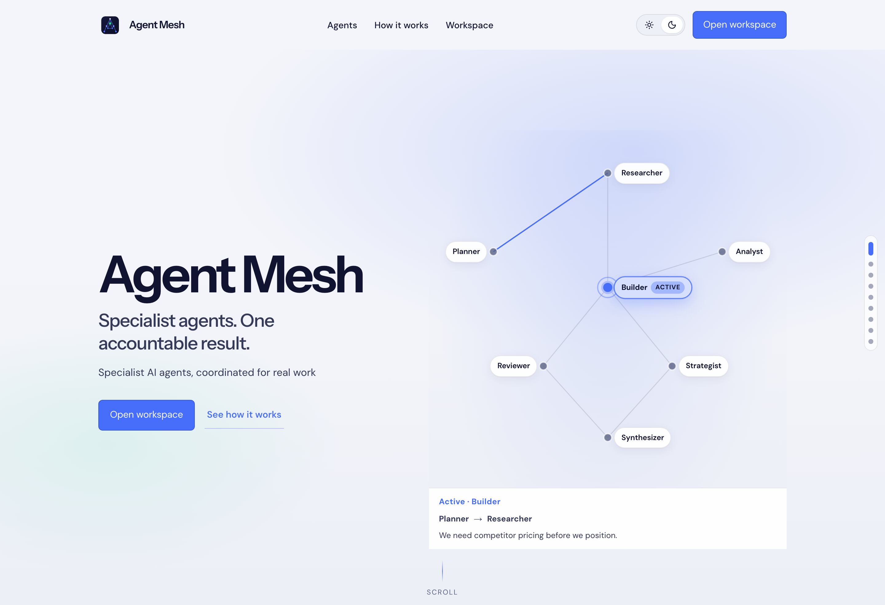
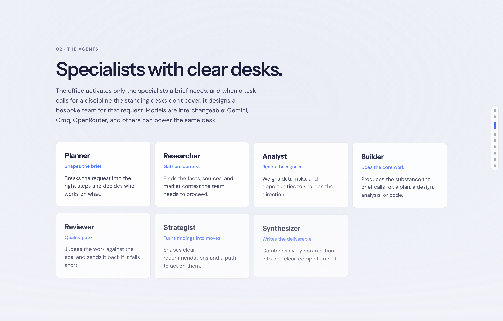
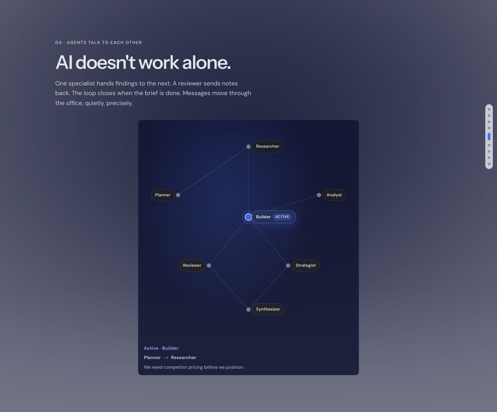
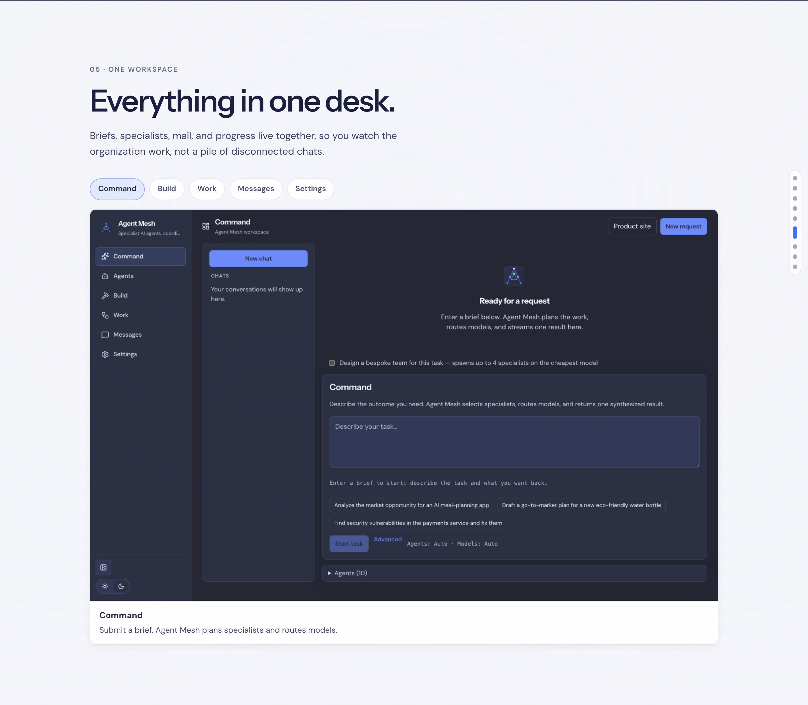
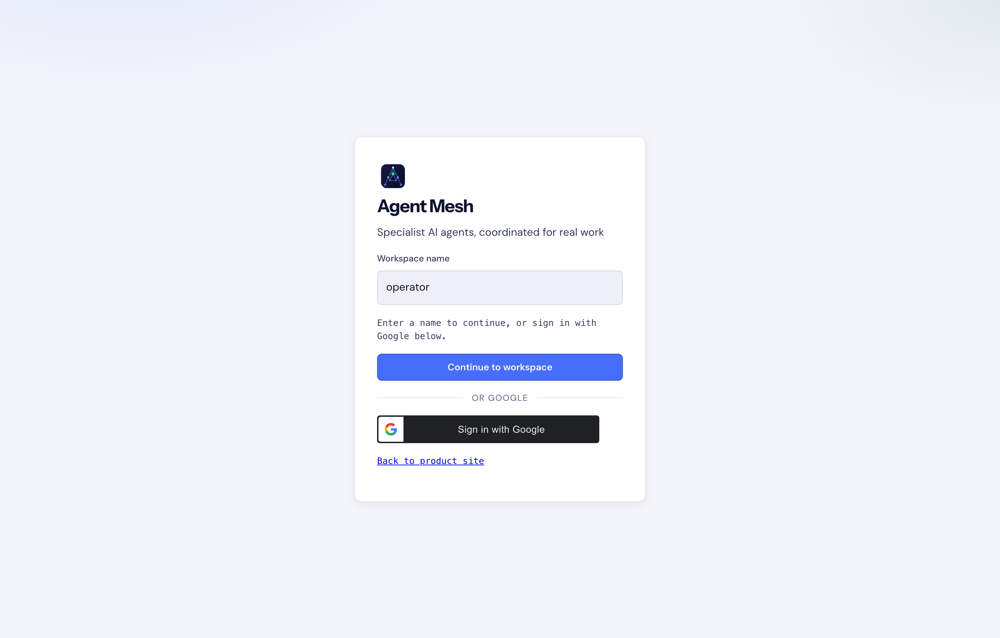
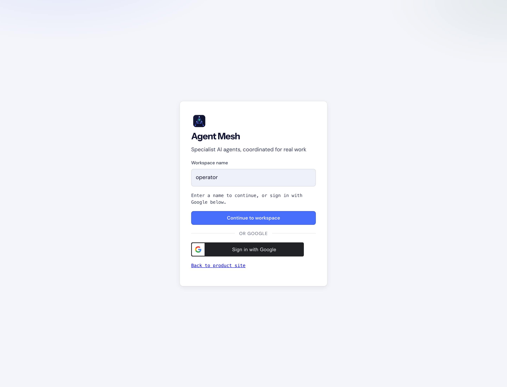
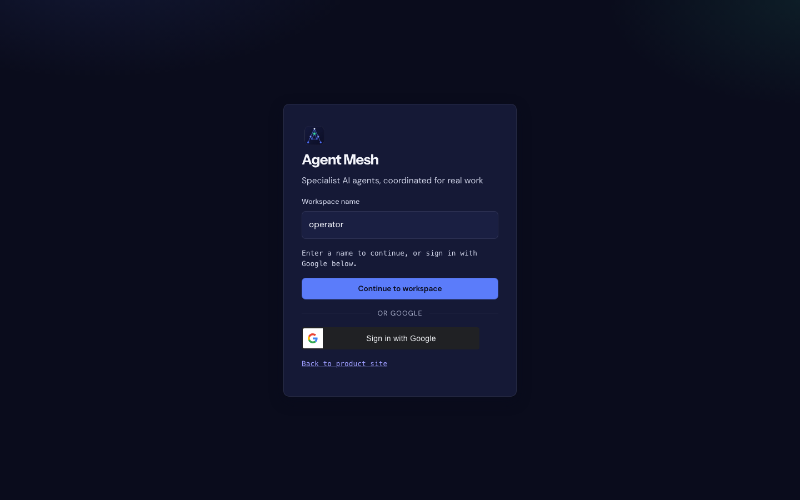

# Agent Mesh

Specialist AI agents, coordinated for real work.

Submit one brief. Agent Mesh selects the right specialists, builds a workflow, routes each step to a model provider, and returns a single synthesized result.

**Personal repository:** https://github.com/Soumen2581/Capstone-Project  
**Wiki home:** [`docs/wiki/Home.md`](docs/wiki/Home.md)  
**Pending uploads:** [`MISSING_SUBMISSION_FILES.md`](MISSING_SUBMISSION_FILES.md)  
**Audit checklist (Sprint 0–2):** [`docs/AUDIT_CHECKLIST_SPRINT0-2.md`](docs/AUDIT_CHECKLIST_SPRINT0-2.md)

## Screenshots

<p align="center">
  
</p>

<p align="center">
  
</p>

<p align="center">
  
</p>

<p align="center">
  
</p>

<p align="center">
  
</p>

<p align="center">
  
</p>

<p align="center">
  
</p>

## Quick start (Docker)

```bash
cp .env.example .env
# Add provider keys and a JWT_SECRET in .env (see Deploy below)
docker compose up --build
```

| URL | Purpose |
|-----|---------|
| http://localhost:3000 | Product site |
| http://localhost:3000/login | Sign in |
| http://localhost:3000/office | Workspace |
| http://localhost:8000/docs | API reference |
| http://localhost:8000/healthz | Health check |

Stop with `Ctrl+C`, or run detached: `docker compose up --build -d`.

## Verified product scope (Sprint 0–2 MVP + polish)

Aligned with [`docs/AUDIT_CHECKLIST_SPRINT0-2.md`](docs/AUDIT_CHECKLIST_SPRINT0-2.md):

- Capability-based specialist selection and DAG planning
- Parallel / sequential execution with retries, skip, approve/reject, cancel/resume
- PostgreSQL-backed workflows; Redis for queues and rate limits
- Provider routing (Gemini, Groq, OpenAI, Claude, OpenRouter, …) + Free Only
- Workspace: Command, Build, Work, Messages, Agents, Settings
- Continuous Command chat (history stays in one thread; Enter to send)
- Clean markdown answers; downloadable files when the brief asks for a file
- Product site: section scroll flow, section motion, React Bits ambient backgrounds
- Google sign-in or local operator access for development
- CI: lint, types, pytest, Docker, gitleaks, Playwright smoke

## Configuration

Copy `.env.example` to `.env`. Important variables:

| Variable | Notes |
|----------|--------|
| `AUTH_MODE` | `header` for local operator + Google Bearer; `google` for Google sessions only |
| `GOOGLE_CLIENT_ID` / `NEXT_PUBLIC_GOOGLE_CLIENT_ID` | Same OAuth Web client ID |
| `JWT_SECRET` | Required to issue Google sessions; required in production |
| `CORS_ALLOW_ORIGINS` | Your frontend origin(s), comma-separated |
| `*_API_KEY` | Provider keys (Groq, Google, OpenAI, …) |
| `ENVIRONMENT` | Use `production` when deploying |

Never commit `.env`.

## Deploy

1. Set `ENVIRONMENT=production`
2. Set a strong `JWT_SECRET` and `POSTGRES_PASSWORD`
3. Set `ENCRYPTION_KEY` (Fernet key) for stored provider credentials
4. Set `AUTH_MODE=google` (recommended) or `header` if you intentionally allow operator headers
5. Configure Google OAuth authorized origins for your public URL
6. Set `NEXT_PUBLIC_API_BASE_URL` and `CORS_ALLOW_ORIGINS` to your public API / site URLs
7. Attach provider API keys or connect them in Settings after launch
8. Run database migrations on first boot

```bash
docker compose up --build -d
```

Production URL (when live): see pending row in [`MISSING_SUBMISSION_FILES.md`](MISSING_SUBMISSION_FILES.md).

## Docs & deliverables

| Doc | Link |
|-----|------|
| Wiki | [`docs/wiki/Home.md`](docs/wiki/Home.md) |
| Architecture | [`docs/architecture.md`](docs/architecture.md) |
| ADRs | [`docs/adr/`](docs/adr/) |
| Sprint 0–2 audit | [`docs/AUDIT_CHECKLIST_SPRINT0-2.md`](docs/AUDIT_CHECKLIST_SPRINT0-2.md) |
| Missing / pending files (ready links) | [`MISSING_SUBMISSION_FILES.md`](MISSING_SUBMISSION_FILES.md) |
| Technical paper (owner upload) | [`docs/paper/CS691_Technical_Paper.pdf`](docs/paper/CS691_Technical_Paper.pdf) |

Course remote is **read-only** reference only: https://github.com/htmw/F2026-T2-Phoenix

## Development

```bash
make install    # backend venv + frontend deps
make check      # lint, typecheck, tests
make up         # full stack
```

Frontend: Next.js App Router in `frontend/`  
Backend: FastAPI modular monolith in `backend/`

## License

Proprietary — all rights reserved unless otherwise noted.
