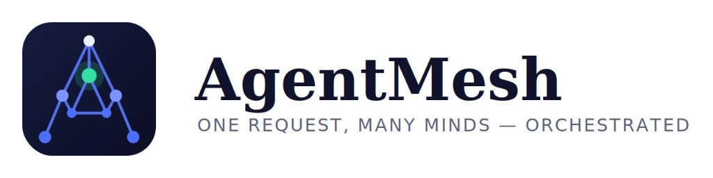
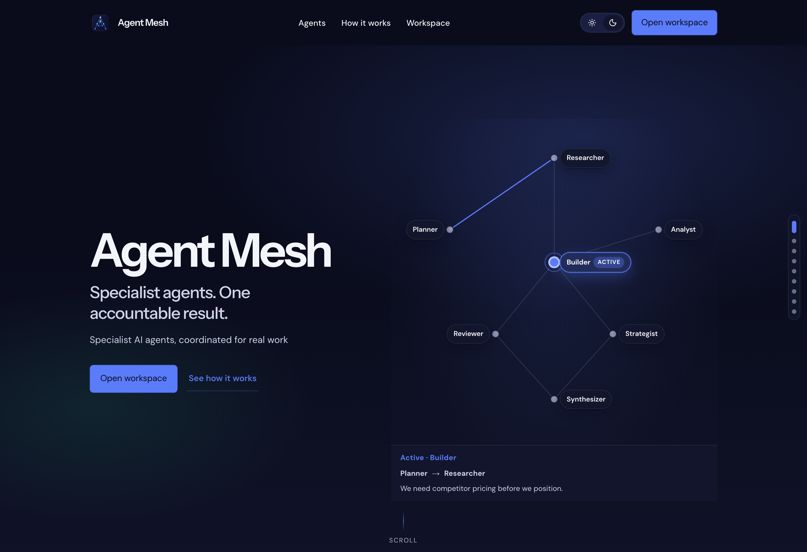
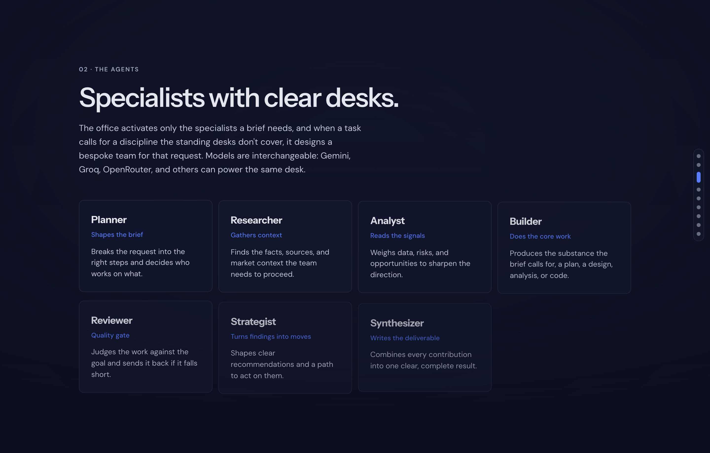
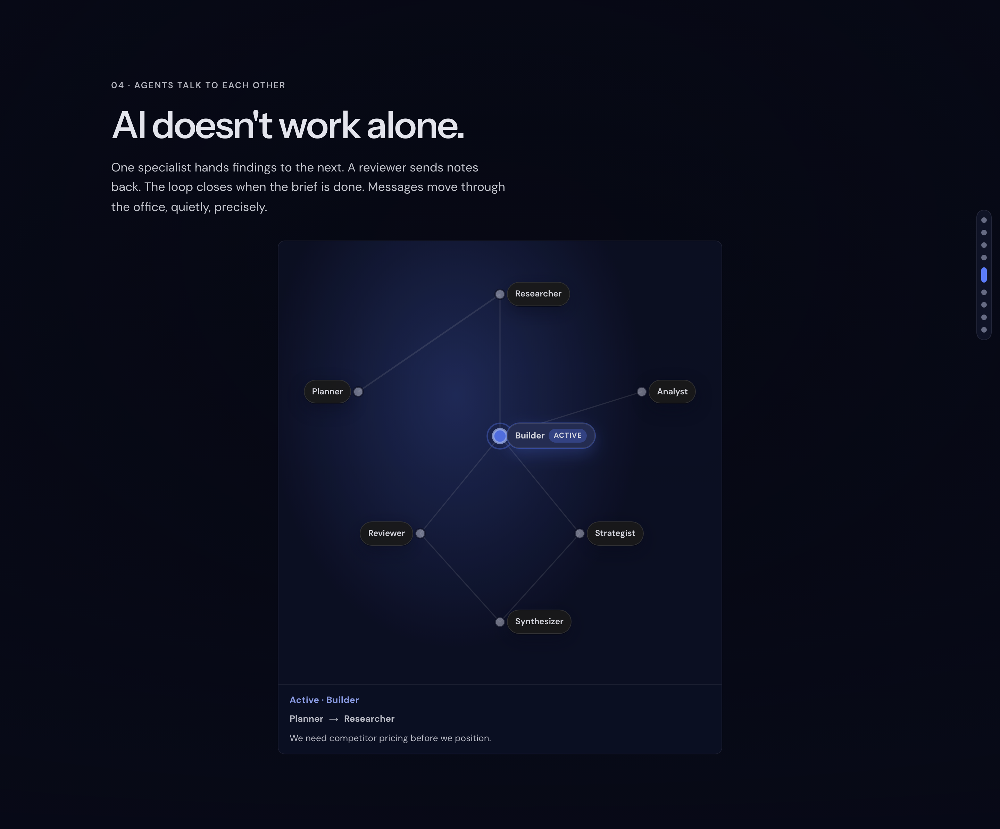
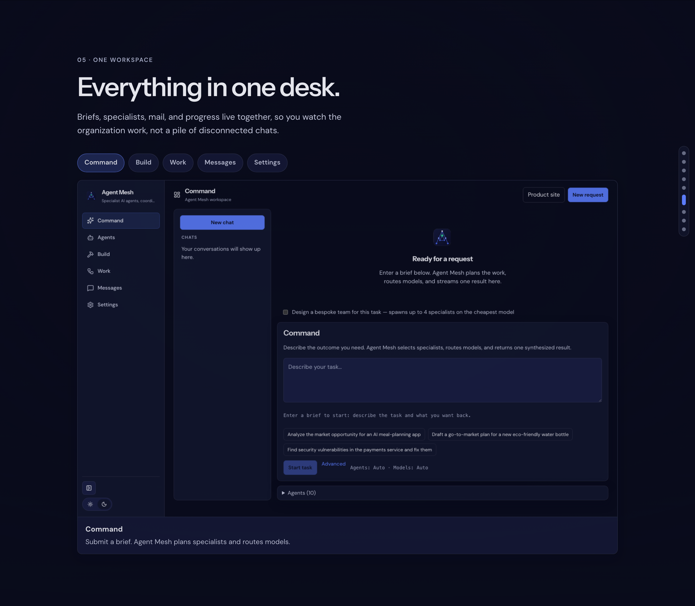
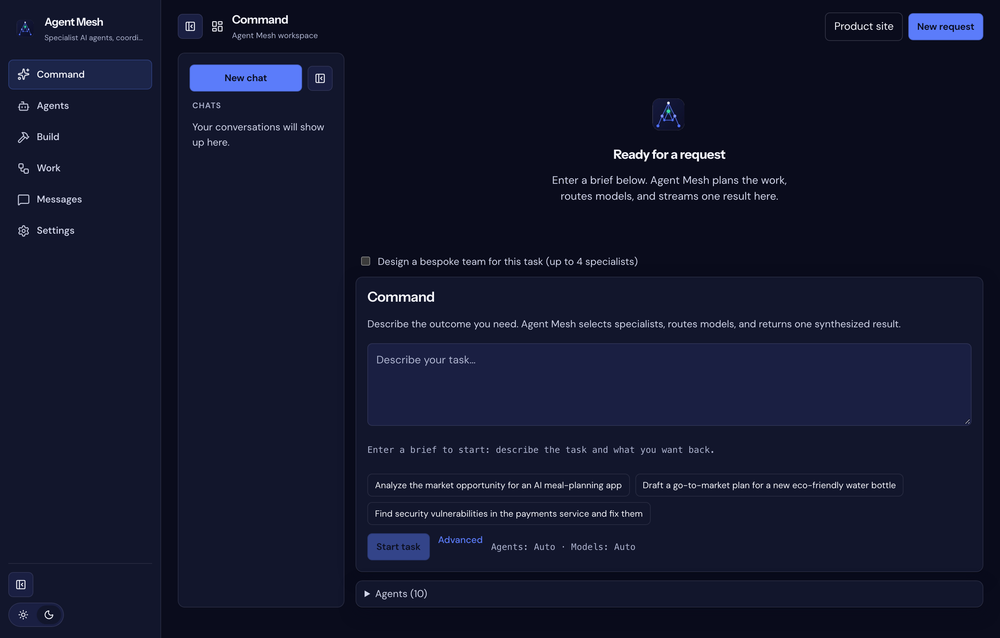
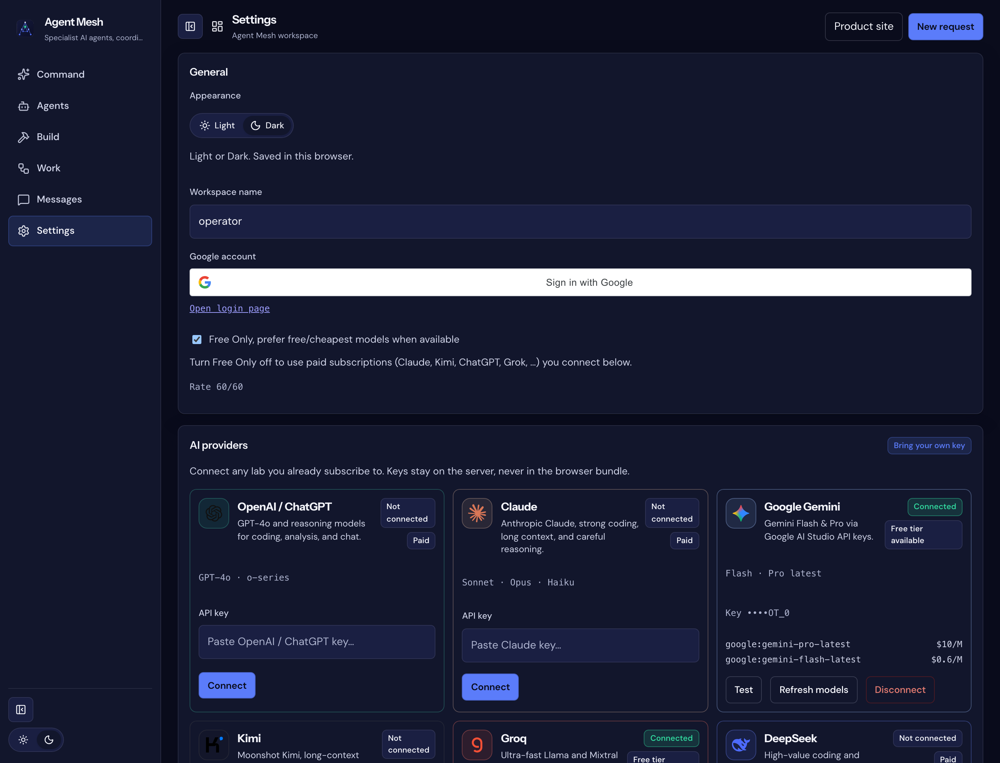
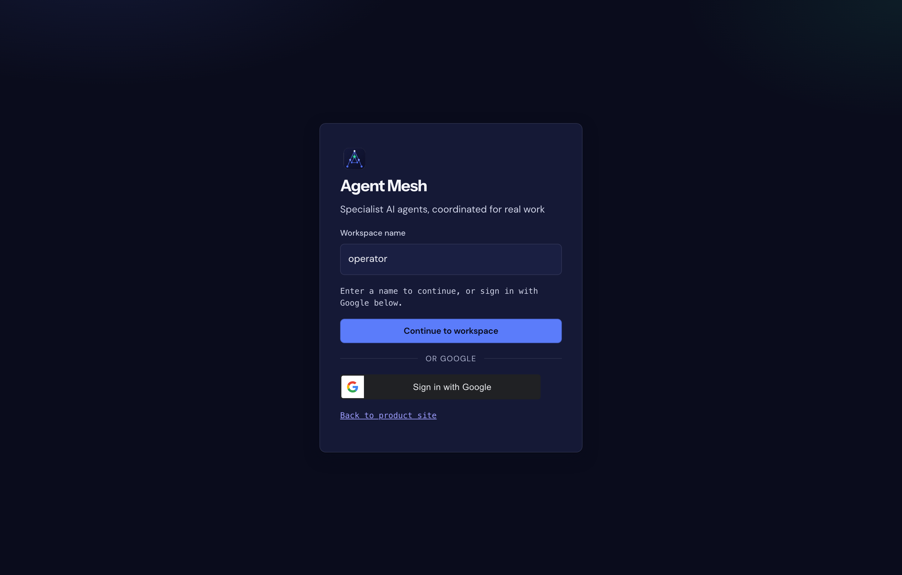
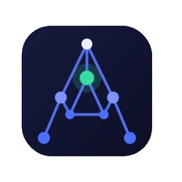

# Agent Mesh

<div align="center">
  
  <br/><br/>
  <b>From one brief to a coordinated specialist team — select, route, execute, synthesise.</b><br/>
  <i>AI-assisted multi-agent orchestration with explainable workflows and shareable results.</i><br/>
  <br/>
  <b>Team 2 — Phoenix</b> · Personal monorepo: <a href="https://github.com/Soumen2581/Capstone-Project">Soumen2581/Capstone-Project</a>
</div>

<br/>

---

## Project Description

Agent Mesh is a web-based platform that uses specialised AI agents and an orchestration engine to handle complex, multi-step requests.
For practitioners, researchers, and engineering teams who submit work too complex for a single model call, the Agent Mesh app analyses the brief, activates only the agents that are needed, and runs them in the right order — providing faster, coordinated, data-driven delivery.
Unlike traditional multi-model chat tools that broadcast the same prompt to every model and leave coordination to the human, Agent Mesh decides what to run, what *not* to run, which model powers each step, and how results are synthesised.

### Why this matters
Complex requests such as “audit this code, fix the critical issues, write tests, and produce a report” are **many tasks with dependencies**, not one prompt. Manual prompting is **slow and inconsistent**; fan-out chat tools **multiply cost** without adding control.
Agent Mesh addresses this with capability-driven selection, workflow graphs, and multi-provider routing.

### Target users
Designed for **individuals, researchers, and engineering teams** who need consistent and scalable multi-step AI work with auditability.

### Scope note
Agent Mesh is an **AI-assisted orchestration and research/engineering support tool**, **not a substitute for professional judgment** or regulated clinical/legal decision-making.

### Expected benefits
Improved **consistency**, **scalability**, and reduced **wasted spend** through selective agent activation and transparent cost/routing.

---

## Team Members

<table>
  <tr>
    <td align="center" colspan="3">
      <br/>
      <b>Henry Wong</b><br/>
      (<a href="mailto:hwong@pace.edu">hwong@pace.edu</a>)<br/>
      AI/ML Advisor
    </td>
  </tr>
  <tr>
    <td align="center" colspan="3">
      <br/>
      <b>Dhwani Dobariya</b><br/>
      (<a href="https://github.com/DhwaniDobariya">DhwaniDobariya</a>)<br/>
      Team Leader / Product Owner<br/>
      <a href="mailto:dd46109n@pace.edu">dd46109n@pace.edu</a>
    </td>
  </tr>
  <tr>
    <td align="center" width="33%">
      <br/>
      <b>Aniruddha Rath</b><br/>
      (<a href="https://github.com/AniRath020697">AniRath020697</a>)<br/>
      Backend Engineer<br/>
      <a href="mailto:ar35067n@pace.edu">ar35067n@pace.edu</a>
    </td>
    <td align="center" width="33%">
      <br/>
      <b>Puneet Tulsiani</b><br/>
      (<a href="https://github.com/puneett12">puneett12</a>)<br/>
      Frontend Engineer<br/>
      <a href="mailto:pt00057n@pace.edu">pt00057n@pace.edu</a>
    </td>
    <td align="center" width="33%">
      <br/>
      <b>Soumen Nageshkar</b><br/>
      (<a href="https://github.com/Soumen2581">Soumen2581</a>)<br/>
      Full-Stack / Platform Engineer<br/>
      <a href="mailto:sn92267n@pace.edu">sn92267n@pace.edu</a>
    </td>
  </tr>
  <tr>
    <td align="center" width="33%">
      <br/>
      <b>Sutej Kulkarni</b><br/>
      (<a href="https://github.com/Sutej12">Sutej12</a>)<br/>
      DevOps / Infrastructure Engineer<br/>
      <a href="mailto:sk85676n@pace.edu">sk85676n@pace.edu</a>
    </td>
    <td align="center" width="33%">
      <br/>
      <b>Gurjot Singh</b><br/>
      (<a href="https://github.com/gurjotsingh01">gurjotsingh01</a>)<br/>
      QA / Test Engineer<br/>
      <a href="mailto:gs37994n@pace.edu">gs37994n@pace.edu</a>
    </td>
    <td align="center" width="33%">
      <br/>
      <b>Om Jadhav</b><br/>
      (<a href="https://github.com/jadhavom37">jadhavom37</a>)<br/>
      Documentation & Agile Lead<br/>
      <a href="mailto:oj82545n@pace.edu">oj82545n@pace.edu</a>
    </td>
  </tr>
</table>

---

## Screenshots

<p align="center">
  
</p>

<p align="center">
  
</p>

<p align="center">
  
</p>

<p align="center">
  
</p>

<p align="center">
  
</p>

<p align="center">
  
</p>

<p align="center">
  
</p>

## Project Design

### High-level architecture
Agent Mesh follows an end-to-end modular-monolith pipeline (verified through Sprint 2; product polish continues on personal `master` / feature branches):

- **Frontend (Web UI):** Next.js (App Router) + TypeScript + CSS — product site with section scroll/motion and React Bits ambients; `/login`; `/office` workspace (Command, Build, Work, Messages, Agents, Settings)
- **Backend API:** Python + FastAPI + operator identity / Google session JWT — orchestration, agent registry, workflow engine, provider adapters, rate limits
- **Orchestration / AI layer:** Capability analysis + multi-agent DAG engine — selects agents, routes models, validates outputs, synthesises a final result; optional generative teams
- **Data Layer:** PostgreSQL + Redis — durable workflows/results in Postgres; queues, locks, and cache in Redis

### Core workflow
1. **Brief** — Operator submits a task (or follow-up) in `/office` (Enter to send; history stays in one chat)
2. **Analyse** — Capability analysis determines which specialist agents are required
3. **Plan** — A workflow DAG is built (sequence, parallel joins, conditionals / approval gates)
4. **Route** — Each agent is bound to a suitable model/provider
5. **Execute** — Agents run with retries, skips, hand-offs, and optional human approval
6. **Synthesise** — Validated outputs become one clean chat answer (markdown); file briefs get a download
7. **Persist** — Workflow, executions, cost, and conversation history are stored in PostgreSQL

### MVP direction
- Web-based interface (product site + `/office`)
- Capability-driven agent selection
- Workflow engine (DAG: sequential / parallel / conditional)
- Multi-provider model routing with fallback
- Continuous chat threads with readable replies and optional file downloads
- Optional generative agent teams (Level 3)
- Docker Compose one-command local run
- Offline demo mode when no API keys are configured

---

## Languages and Tools

### Languages
<p>
  
  
  
</p>

### Frontend
<p>
  
  
  
  
</p>

### Backend
<p>
  
  
  
  
</p>

### Orchestration / AI
<p>
  
  
  
  
  
</p>

### Database & Cloud
<p>
  
  
  
</p>

### Tools
<p>
  
  
  
  
</p>

### Testing & Quality
<p>
  
  
  
  
</p>

---

# Course Deliverables

## Presentations (Sprint Reviews)

### Sprint 0
- [Watch deliverable Sprint 0 presentation video](https://www.youtube.com/watch?v=N24yQqrouek)
- [Download deliverable Sprint 0 presentation video](https://github.com/Soumen2581/Capstone-Project/blob/master/docs/sprints/AgentMesh_Sprint0_Presentation.mp4)
- [Deliverable presentation slide as PowerPoint](https://github.com/Soumen2581/Capstone-Project/blob/master/docs/sprints/AgentMesh_Sprint0_Presentation_final.pptx)
- [Deliverable presentation slide as PDF](https://github.com/Soumen2581/Capstone-Project/blob/master/docs/sprints/AgentMesh_Sprint0_Presentation_final.pdf)

### Sprint 1
#### Sprint 1 Presentation Video
- [Watch Sprint 1 Presentation Video](https://www.youtube.com/watch?v=NQy178euy0E)
- [Download Sprint 1 Presentation Video](https://github.com/Soumen2581/Capstone-Project/releases/download/sprint-1/AgentMesh_Sprint1_Presentation.mp4)
1a. [View Sprint 1 Presentation Slides as PDF](https://github.com/Soumen2581/Capstone-Project/blob/master/docs/sprints/AgentMesh_Sprint1_Presentation.pdf)
1b. [Download Sprint 1 Presentation Slides as PowerPoint](https://github.com/Soumen2581/Capstone-Project/blob/master/docs/sprints/AgentMesh_Sprint1_Presentation.pptx)
#### Live Demo
1d. [Watch Sprint 1 Demo](https://www.youtube.com/watch?v=Dd_9gl4ELgk) | [Download Sprint 1 Demo (mp4)](https://github.com/Soumen2581/Capstone-Project/raw/master/docs/sprints/AgentMesh_Sprint1_Demo.mp4)
1e. [Sprint 1 Front-End Source Code](https://github.com/Soumen2581/Capstone-Project/tree/master/frontend) | [Sprint 1 Back-End Source Code](https://github.com/Soumen2581/Capstone-Project/tree/master/backend)

### Sprint 2
#### Sprint 2 Presentation Video
- [Watch Sprint 2 Presentation Video](https://www.youtube.com/watch?v=QPmhcV6kkbc)
- [Download Sprint 2 Presentation Video](https://github.com/Soumen2581/Capstone-Project/releases/download/sprint-2/AgentMesh_Sprint2_Presentation.mp4)
2a. [View Sprint 2 Presentation Slides as PDF](https://github.com/Soumen2581/Capstone-Project/blob/master/docs/sprints/AgentMesh_Sprint2_Presentation.pdf)
2b. [Download Sprint 2 Presentation Slides as PowerPoint](https://github.com/Soumen2581/Capstone-Project/blob/master/docs/sprints/AgentMesh_Sprint2_Presentation.pptx)
#### Live Demo
2d. [Watch Sprint 2 Demo](https://www.youtube.com/watch?v=73D30fI-xio) | [Download Sprint 2 Demo (mp4)](https://github.com/Soumen2581/Capstone-Project/raw/master/docs/sprints/AgentMesh_Sprint2_Demo.mp4)
2e. [Sprint 2 Front-End Source Code](https://github.com/Soumen2581/Capstone-Project/tree/master/frontend) | [Sprint 2 Back-End Source Code](https://github.com/Soumen2581/Capstone-Project/tree/master/backend)

### Sprint 3
> Links are ready; upload artifacts when available. Tracker: [`MISSING_SUBMISSION_FILES.md`](https://github.com/Soumen2581/Capstone-Project/blob/master/MISSING_SUBMISSION_FILES.md).

#### Sprint 3 Presentation Video
- Watch: *(add YouTube URL when published)*
- [Download Sprint 3 Presentation Video](https://github.com/Soumen2581/Capstone-Project/releases/download/sprint-3/AgentMesh_Sprint3_Presentation.mp4)
3a. [View Sprint 3 Presentation Slides as PDF](https://github.com/Soumen2581/Capstone-Project/blob/master/docs/sprints/AgentMesh_Sprint3_Presentation.pdf)
3b. [Download Sprint 3 Presentation Slides as PowerPoint](https://github.com/Soumen2581/Capstone-Project/blob/master/docs/sprints/AgentMesh_Sprint3_Presentation.pptx)
#### Live Demo
3d. [Watch Sprint 3 Demo](#) | [Download Sprint 3 Demo (mp4)](https://github.com/Soumen2581/Capstone-Project/raw/master/docs/sprints/AgentMesh_Sprint3_Demo.mp4)
3e. [Front-End Source Code](https://github.com/Soumen2581/Capstone-Project/tree/master/frontend) | [Back-End Source Code](https://github.com/Soumen2581/Capstone-Project/tree/master/backend)
#### Status notes
- Implementation notes: [SPRINT_3_STATUS.md](https://github.com/Soumen2581/Capstone-Project/blob/master/docs/SPRINT_3_STATUS.md) · [SPRINT_3_READINESS.md](https://github.com/Soumen2581/Capstone-Project/blob/master/docs/SPRINT_3_READINESS.md) · [SPRINT_3_IMPLEMENTATION_ROADMAP.md](https://github.com/Soumen2581/Capstone-Project/blob/master/docs/SPRINT_3_IMPLEMENTATION_ROADMAP.md)

## Sprint Burndown Charts and Completed Tasks

### Sprint 0
- Team Working Agreement (signed PDF): [Teamwork_Agreement_Team2_Phoenix.pdf](https://github.com/Soumen2581/Capstone-Project/blob/master/docs/agile/Teamwork_Agreement_Team2_Phoenix.pdf)
- [Sprint 0 Completed Tasks](https://github.com/Soumen2581/Capstone-Project/blob/master/docs/wiki/sprints/sprint-0-completed-tasks.jpg) (SCRUM board)

### Sprint 1
- [Sprint 1 Burndown Chart](https://github.com/Soumen2581/Capstone-Project/blob/master/docs/wiki/sprints/sprint-1-burndown.png) | [Sprint 1 Completed Tasks](https://github.com/Soumen2581/Capstone-Project/blob/master/docs/wiki/sprints/sprint-1-completed-tasks.png) (SCRUM board)

### Sprint 2
- [Sprint 2 Burndown Chart](https://github.com/Soumen2581/Capstone-Project/blob/master/docs/wiki/sprints/sprint-2-burndown.png) | [Sprint 2 Completed Tasks](https://github.com/Soumen2581/Capstone-Project/blob/master/docs/wiki/sprints/sprint-2-completed-tasks.png) (SCRUM board)

### Sprint 3
- [Sprint 3 Burndown Chart](https://github.com/Soumen2581/Capstone-Project/blob/master/docs/wiki/sprints/sprint-3-burndown.png) | [Sprint 3 Completed Tasks](https://github.com/Soumen2581/Capstone-Project/blob/master/docs/wiki/sprints/sprint-3-completed-tasks.png) *(pending upload)*

## Sprint Planning

### Sprint 1
1. [Watch Sprint 1 Planning Video](https://www.youtube.com/watch?v=9tktC_Bq3pc) | [Download mp4 File](https://github.com/Soumen2581/Capstone-Project/releases/download/sprint-1/AgentMesh_Sprint1_Planning.mp4)

### Sprint 2
1. [Watch Sprint 2 Planning Video](https://www.youtube.com/watch?v=xgsjFYFc9og) | [Download mp4 File](https://github.com/Soumen2581/Capstone-Project/releases/download/sprint-2/AgentMesh_Sprint2_Planning.mp4)

### Sprint 3
1. Watch: *(add YouTube URL when published)* | [Download mp4](https://github.com/Soumen2581/Capstone-Project/releases/download/sprint-3/AgentMesh_Sprint3_Planning.mp4)

## Retrospectives

### Sprint 0
0a. [Watch Sprint 0 Retrospective Video](https://www.youtube.com/watch?v=OkWZ0Ngln0w) | [Download mp4](https://github.com/Soumen2581/Capstone-Project/blob/master/docs/sprints/AgentMesh_Sprint0_Retrospective.mp4)

### Sprint 1
1. [Watch Sprint 1 Retrospective Video](https://www.youtube.com/watch?v=xaOZLz6WfMU) | [Download mp4 File](https://github.com/Soumen2581/Capstone-Project/releases/download/sprint-1/AgentMesh_Sprint1_Retrospective.mp4)

### Sprint 2
1. [Watch Sprint 2 Retrospective Video](https://www.youtube.com/watch?v=twiKLbI92vU) | [Download mp4 File](https://github.com/Soumen2581/Capstone-Project/releases/download/sprint-2/AgentMesh_Sprint2_Retrospective.mp4)

### Sprint 3
1. Watch: *(add YouTube URL when published)* | [Download mp4](https://github.com/Soumen2581/Capstone-Project/releases/download/sprint-3/AgentMesh_Sprint3_Retrospective.mp4)

## Team Working Agreement
[Team Working Agreement as PDF](https://github.com/Soumen2581/Capstone-Project/blob/master/docs/agile/Teamwork_Agreement_Team2_Phoenix.pdf) | [Team Working Agreement (markdown)](https://github.com/Soumen2581/Capstone-Project/blob/master/docs/agile/team-working-agreement.md)

## Diagrams
- Architecture write-up: [docs/architecture.md](https://github.com/Soumen2581/Capstone-Project/blob/master/docs/architecture.md)
- [Architecture Diagram](https://github.com/Soumen2581/Capstone-Project/blob/master/docs/wiki/diagrams/architecture-diagram.png)
- [Sequence Diagram](https://github.com/Soumen2581/Capstone-Project/blob/master/docs/wiki/diagrams/sequence-diagram.png)
- [Context Diagram](https://github.com/Soumen2581/Capstone-Project/blob/master/docs/wiki/diagrams/context-diagram.png)
- [ER Diagram](https://github.com/Soumen2581/Capstone-Project/blob/master/docs/wiki/diagrams/er-diagram.png)
- [State Diagram](https://github.com/Soumen2581/Capstone-Project/blob/master/docs/wiki/diagrams/state-diagram.png)
- [Class Diagram](https://github.com/Soumen2581/Capstone-Project/blob/master/docs/wiki/diagrams/class-diagram.png)

## Additional Project Artifacts

### Product Personas

From Sprint 0 — *Who we're building Agent Mesh for*:

- [Persona 1: Priya, Software Engineering Lead (PDF)](https://github.com/Soumen2581/Capstone-Project/blob/master/docs/wiki/personas/persona-priya.pdf)
- [Persona 2: Daniel, Data Analyst (PDF)](https://github.com/Soumen2581/Capstone-Project/blob/master/docs/wiki/personas/persona-daniel.pdf)
- [Persona 3: Aisha, Technical Product Manager (PDF)](https://github.com/Soumen2581/Capstone-Project/blob/master/docs/wiki/personas/persona-aisha.pdf)

### Product User Stories and Acceptance Criteria
- [View User Stories & Acceptance Criteria as PDF](https://github.com/Soumen2581/Capstone-Project/blob/master/docs/agile/user-stories/AgentMesh_UserStories.pdf) | [Download as Excel Workbook](https://github.com/Soumen2581/Capstone-Project/raw/master/docs/agile/user-stories/AgentMesh_UserStories.xlsx)
- [User Stories v2 (PDF)](https://github.com/Soumen2581/Capstone-Project/blob/master/docs/agile/user-stories/AgentMesh_UserStories_v2.pdf) | [Excel](https://github.com/Soumen2581/Capstone-Project/raw/master/docs/agile/user-stories/AgentMesh_UserStories_v2.xlsx)

### User Stories and Acceptance Criteria (Sprint-wise)

#### Sprint 1
- [View Sprint 1 User Stories as PDF](https://github.com/Soumen2581/Capstone-Project/blob/master/docs/agile/user-stories/AgentMesh_Sprint1_UserStories.pdf) | [Download as Excel Workbook](https://github.com/Soumen2581/Capstone-Project/raw/master/docs/agile/user-stories/AgentMesh_Sprint1_UserStories.xlsx)

#### Sprint 2
- [View Sprint 2 User Stories as PDF](https://github.com/Soumen2581/Capstone-Project/blob/master/docs/agile/user-stories/AgentMesh_Sprint2_UserStories.pdf) | [Download as Excel Workbook](https://github.com/Soumen2581/Capstone-Project/raw/master/docs/agile/user-stories/AgentMesh_Sprint2_UserStories.xlsx)

#### Sprint 3
- [View Sprint 3 User Stories as PDF](https://github.com/Soumen2581/Capstone-Project/blob/master/docs/agile/user-stories/AgentMesh_Sprint3_UserStories.pdf) | [Download as Excel Workbook](https://github.com/Soumen2581/Capstone-Project/raw/master/docs/agile/user-stories/AgentMesh_Sprint3_UserStories.xlsx) *(pending upload)*

### Application Test Cases

#### Sprint 1
- [View Test Cases as PDF](https://github.com/Soumen2581/Capstone-Project/blob/master/docs/agile/test-cases/AgentMesh_Sprint1_TestCases.pdf) | [Download as Excel Workbook](https://github.com/Soumen2581/Capstone-Project/raw/master/docs/agile/test-cases/AgentMesh_Sprint1_TestCases.xlsx)

#### Sprint 2
- [View Sprint 2 Test Cases as PDF](https://github.com/Soumen2581/Capstone-Project/blob/master/docs/agile/test-cases/AgentMesh_Sprint2_TestCases.pdf) | [Download as Excel Workbook](https://github.com/Soumen2581/Capstone-Project/raw/master/docs/agile/test-cases/AgentMesh_Sprint2_TestCases.xlsx)

#### Sprint 3
- [View Sprint 3 Test Cases as PDF](https://github.com/Soumen2581/Capstone-Project/blob/master/docs/agile/test-cases/AgentMesh_Sprint3_TestCases.pdf) | [Download as Excel Workbook](https://github.com/Soumen2581/Capstone-Project/raw/master/docs/agile/test-cases/AgentMesh_Sprint3_TestCases.xlsx) *(pending upload)*

## Source Code

- [Frontend](https://github.com/Soumen2581/Capstone-Project/tree/master/frontend)
- [Backend](https://github.com/Soumen2581/Capstone-Project/tree/master/backend)
- [Docs / ADRs / Agile / Wiki](https://github.com/Soumen2581/Capstone-Project/tree/master/docs)
- **Personal working monorepo:** [https://github.com/Soumen2581/Capstone-Project](https://github.com/Soumen2581/Capstone-Project)
- Course team remote (read-only reference): [https://github.com/htmw/F2026-T2-Phoenix](https://github.com/htmw/F2026-T2-Phoenix)
- Pending uploads tracker: [`MISSING_SUBMISSION_FILES.md`](https://github.com/Soumen2581/Capstone-Project/blob/master/MISSING_SUBMISSION_FILES.md)
- Audit checklist: [`docs/AUDIT_CHECKLIST_SPRINT0-2.md`](https://github.com/Soumen2581/Capstone-Project/blob/master/docs/AUDIT_CHECKLIST_SPRINT0-2.md)

```bash
git clone https://github.com/Soumen2581/Capstone-Project.git
cd Capstone-Project
cp .env.example .env
docker compose up --build
```

| URL | What |
|-----|------|
| http://localhost:3000 | Product site |
| http://localhost:3000/login | Sign in |
| http://localhost:3000/office | Workspace |
| http://localhost:8000/docs | API docs |

> **CS 691 technical paper:** not authored in-repo; owner will supply separately → ready path [`docs/paper/CS691_Technical_Paper.pdf`](https://github.com/Soumen2581/Capstone-Project/blob/master/docs/paper/CS691_Technical_Paper.pdf).
